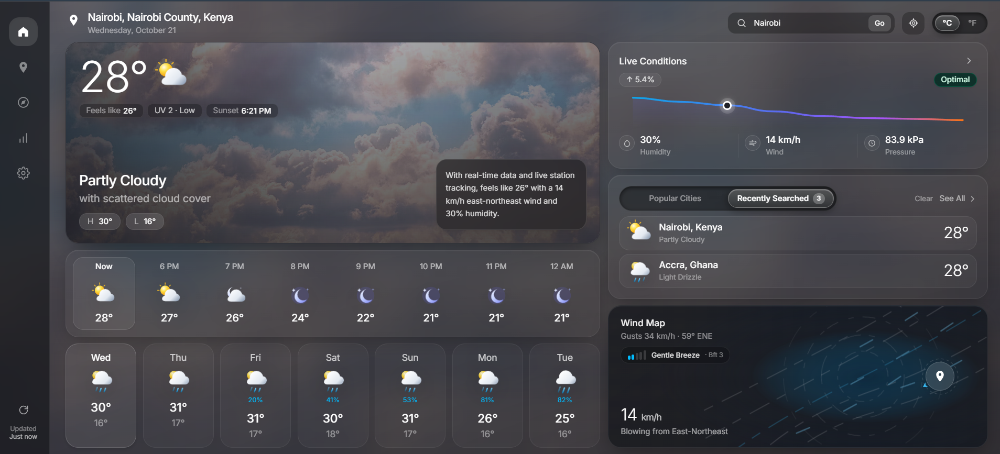

# Weather Forecast

A modern Angular weather app: search any city, see current conditions and a 7-day outlook.



## Stack

- **Angular 22.2** — standalone components, signal forms, zoneless change detection
- **[Open-Meteo](https://open-meteo.com/)** — free geocoding + forecast APIs (no API keys)
- **Tailwind CSS v4**

Previously this project used OpenWeather + HERE with HTTP interceptors and API keys. That flow is replaced by a single service that calls Open-Meteo directly.

## Development

```bash
npm install
npm start
```

Open [http://localhost:4200](http://localhost:4200).

## Build

```bash
npm run build
```

Output is in `dist/weatherapp`.

## API notes

| Step | Endpoint |
|------|----------|
| Geocode city | `https://geocoding-api.open-meteo.com/v1/search` |
| Forecast | `https://api.open-meteo.com/v1/forecast` |

Open-Meteo is free for non-commercial use; see their [terms](https://open-meteo.com/en/terms) for production traffic limits.

## Author

Built with care by [Wayne Gakuo](https://github.com/waynegakuo).
